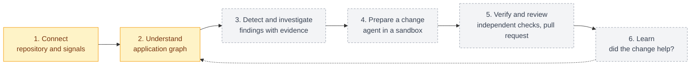
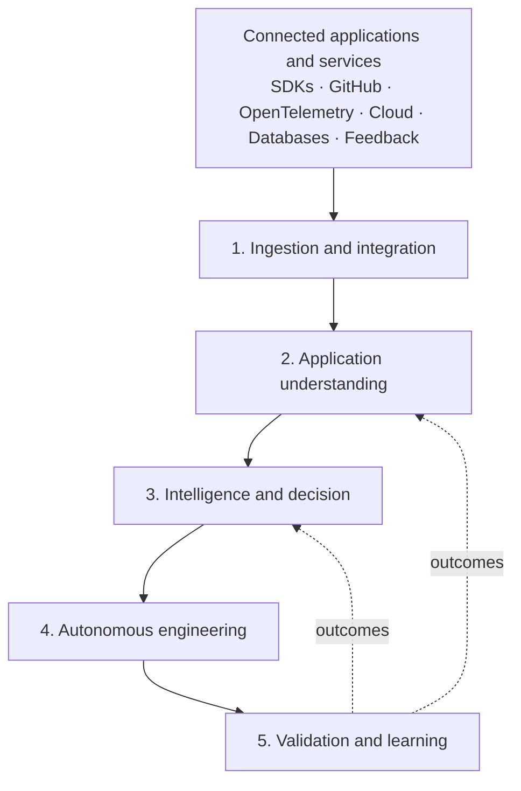

<div align="center">

<picture>
  <source media="(prefers-color-scheme: dark)" srcset="assets/brand/logo-on-dark.svg">
  
</picture>

<h3>Connect your application. Give it a path to improve.</h3>

<p>
CodeMugs plugs into your application, understands it, finds problems in it, investigates them with evidence,<br>
and produces engineering changes that are <b>verified</b> before anyone is asked to trust them.
</p>

[](https://github.com/richid-stack/CodeMugs/actions/workflows/ci.yml)

[](LICENSE)


<p>
<a href="#overview">Overview</a> ·
<a href="#what-exists-today">What exists today</a> ·
<a href="#quick-start">Quick start</a> ·
<a href="#architecture">Architecture</a> ·
<a href="#documentation">Documentation</a> ·
<a href="#licence">Licence</a>
</p>

</div>

> [!WARNING]
> **Pre-alpha.** This repository is the foundation of the engine. Nothing here is production-ready, and nothing runs for real customers. Production readiness is earned through implementation, tests and evidence, tracked in the [release gates](docs/operations/release-gates.md). It is not a property of the technology stack.

## Overview

Most of what explains a problem in an application is spread across its repositories, services, telemetry, deployments and customer feedback. CodeMugs is being built to bring those signals together into one structured understanding of the application, and to use that understanding to propose and verify improvements, with a person deciding what ships.

The engine comes first. There is no frontend yet, by design: once the engine is solid we will know exactly what the frontend needs to be.

### The loop



<sub>Amber: parts exist and are tested, not yet connected end to end. Grey and dashed: planned, not started.</sub>

## What exists today

This table follows the [roadmap](docs/engineering/roadmap.md), which has the detail and the decision record for each row. Where something is built but not yet safe to switch on, the table says so.

| Area                         | What exists                                                                                                                                                                                                     | State                                                                                                             |
| ---------------------------- | --------------------------------------------------------------------------------------------------------------------------------------------------------------------------------------------------------------- | ----------------------------------------------------------------------------------------------------------------- |
| **Tenant isolation**         | PostgreSQL row-level security, forced on every tenant table, with cross-tenant tests that fail when the isolation is removed                                                                                    | Built. Testing behind a connection pooler and measuring overhead are still open                                   |
| **Identity**                 | Organisations, projects, hashed API keys with scopes (`events:write`, `analysis:write`, `analysis:read`), an append-only audit log                                                                              | Built for API keys. No rate limiting, key expiry or rotation, or sign-in for people yet                           |
| **API**                      | Fastify: `POST /v1/events`, `GET /v1/whoami`, liveness and readiness, request IDs, one error shape that never exposes internals                                                                                 | Built, including the routes that connect a repository and ask for an analysis. Nothing reads a graph back yet     |
| **Event ingestion**          | Validated, idempotent, durably stored batches, and background jobs that turn them into hourly counts                                                                                                            | Built. Rate limits, quotas and redaction must exist before real traffic                                           |
| **Jobs**                     | A PostgreSQL job queue and worker, with crash recovery, retries, and long-running jobs                                                                                                                          | Built                                                                                                             |
| **Sandbox**                  | A deny-by-default policy model, a hardened container driver, a gVisor driver, and escape and resource-abuse tests that run in CI                                                                                | Built and tested. **No isolation claim is made** (release gate 8 is not started), and no customer code runs there |
| **Repository understanding** | A read-only GitHub App client, bounded archive unpacking tested against hostile archives, a TypeScript and JavaScript analyser that records facts and never content, graph storage, and the analysis job itself | Built, with a process that runs the job. Tested in pieces, not yet end to end. Nothing runs for a customer        |
| **Demo application**         | A small TypeScript shop with five deliberately seeded faults, each with a detector and proof that undoing the fault restores the shop                                                                           | Built, used as the test subject                                                                                   |

**Not started:** SDKs and OpenTelemetry, detection and diagnosis, engineering agents, learning from outcomes, and the model gateway. There is no frontend, by design.

Every other directory in the tree is a **placeholder** whose README states its responsibility and target phase.

## Principles

Three things are protected throughout development:

1. **The intelligence engine owns the decisions.** Coding agents are replaceable workers.
2. **The Application Intelligence Graph is the foundation of understanding.** Structured context, not raw logs pasted into a model.
3. **Validation and learning are independent of the agents.** An agent saying it succeeded is not evidence that it did.

Rules that apply to every change (the full list is in [AGENTS.md](AGENTS.md)):

- Tenant identity comes from the authenticated credential, never from a request body, a query string or an event.
- Repository contents, logs, telemetry, webhooks and customer messages are untrusted data, never instructions.
- No secrets or personal data in code, logs, fixtures or prompts.
- Customer code, and anything built from it, never runs outside the sandbox. That includes analysing a repository.
- No compliance or production-readiness claim without the evidence behind it.

## Quick start

Requirements: Node 22, pnpm 10 (`corepack enable`), and Docker for the local dependencies.

```bash
pnpm install
pnpm build          # workspace packages are consumed from dist/, so build after changing one
pnpm verify         # build, typecheck, lint, format check, test, smoke test
pnpm dev:api        # run the API with reload (copy .env.example to .env to customise)
pnpm infra:up       # start Postgres and Redis locally
```

The database tests are skipped unless `CODEMUGS_TEST_DATABASE_URL` points at a superuser connection to a disposable PostgreSQL. CI requires them. See [packages/storage](packages/storage/README.md).

## Architecture

Two planes: a **control plane** (organisations, projects, permissions, policies, orchestration) and a **data and intelligence plane** (ingest, understand, detect, investigate, decide, act). Five layers sit across them.



The design is a modular monolith with separate workers and isolated execution infrastructure ([ADR 0005](docs/architecture/decisions/0005-modular-monolith-and-postgres-first-storage.md)). Details are in the [architecture overview](docs/architecture/overview.md) and the [decision records](docs/architecture/decisions/).

### Repository layout

| Directory         | Purpose                                                                                         |
| ----------------- | ----------------------------------------------------------------------------------------------- |
| `apps/`           | Deployable processes: API, ingestion, webhook gateway, workers, scheduler, CLI                  |
| `core/`           | Domain engines: graph, correlation, anomaly detection, root cause, decisions, policy, learning  |
| `intelligence/`   | Context building, evidence ledger, reasoning, hypothesis testing, evaluation, memory, retrieval |
| `engineering/`    | Agent orchestration, sandboxing, git, tests, review, pull requests                              |
| `integrations/`   | Connectors to GitHub, OpenTelemetry, clouds, databases and other systems                        |
| `packages/`       | Shared libraries: SDKs, model gateway, auth, security, storage, schemas, configuration          |
| `infrastructure/` | Docker, database, messaging, observability, secrets, deployment                                 |
| `tests/`          | Integration, end-to-end, security, performance, reliability, agent evaluations, the demo app    |
| `docs/`           | Architecture, security, engineering and operations documentation                                |
| `site/`           | The landing page (a draft concept, not deployed)                                                |
| `assets/`         | Logo files and the repository's social preview image                                            |

## Documentation

- **Start here:** [Architecture overview](docs/architecture/overview.md) · [Roadmap and phases](docs/engineering/roadmap.md) · [Glossary](docs/architecture/glossary.md) · [Open questions](docs/architecture/open-questions.md)
- **Product:** [Product requirements (draft)](docs/product/prd.md) · [Data model (draft)](docs/data-model/overview.md)
- **Engineering:** [Engineering standards](docs/engineering/standards.md) · [API conventions](docs/api/conventions.md) · [Decision records](docs/architecture/decisions/) · [GitHub repository setup](docs/engineering/repository-setup.md)
- **Security:** [Threat model (draft)](docs/security/threat-model.md) · [Data classification (draft)](docs/security/data-classification.md) · [Security policy](SECURITY.md)
- **Operations:** [Release gates](docs/operations/release-gates.md) · [GitHub App key](docs/operations/github-app-key.md)

Documents marked _draft_ are drafts: they need the owner's review and may change.

## The landing page

[`site/`](site/README.md) holds a single-file landing page for CodeMugs. It is a **draft concept**: it describes the planned product, most of what it shows is not built, and it is not deployed anywhere. Open `site/index.html` in a browser to preview it, and read [`site/README.md`](site/README.md) for what has to change before it goes live. The logo files are in [`assets/brand/`](assets/brand/README.md).

## Contributing and security

Outside contributions are not accepted yet: a contributor agreement has to be set up first (see [CONTRIBUTING](CONTRIBUTING.md)). Issues are welcome. Report a vulnerability privately through the repository's **Security** tab, as described in the [security policy](SECURITY.md).

## Licence

Source-available under the [Functional Source License](LICENSE) (FSL-1.1-ALv2), Copyright 2026 Richard Mensah.

You may use, copy, modify and redistribute the code for any purpose except a Competing Use: offering it to others as a commercial product or service that substitutes for it or does the same job. Internal use, non-commercial education and non-commercial research are permitted. Each version converts to the Apache License 2.0 on the second anniversary of its release. This is **not** an open-source licence. The reasoning is in [ADR 0008](docs/architecture/decisions/0008-functional-source-license.md).
