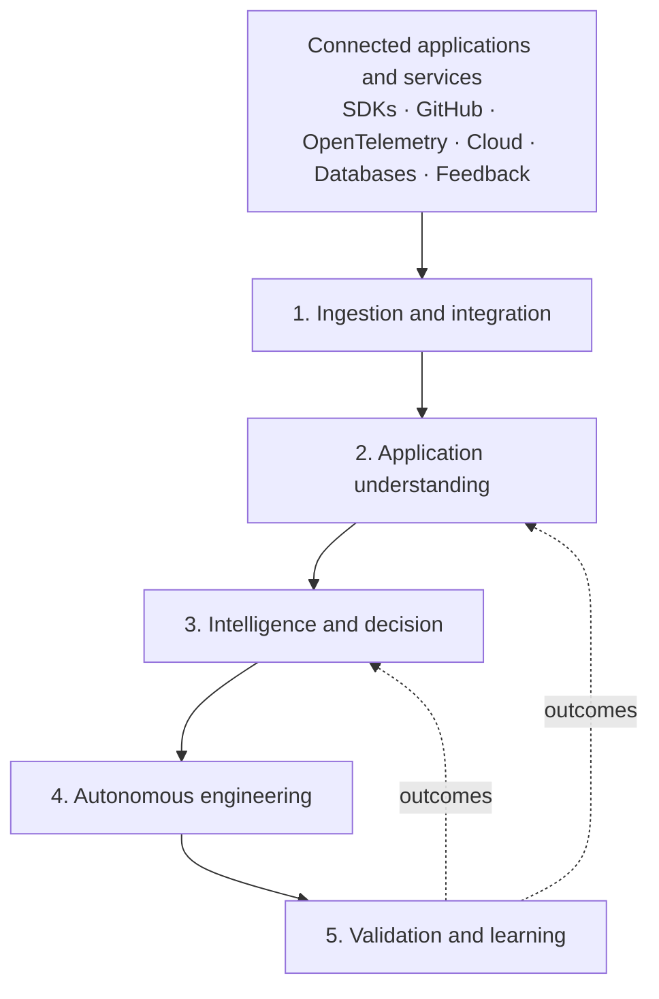

# Architecture overview

This is the conceptual architecture. It describes the target system, not what is built today. See the [roadmap](../engineering/roadmap.md) for the build order and the [README](../../README.md) for the current state.

## Two planes

| Plane                           | Responsibility                                                                                                                         |
| ------------------------------- | -------------------------------------------------------------------------------------------------------------------------------------- |
| **Control plane**               | Organisations, projects, integrations, permissions, policies, configuration, billing and orchestration                                 |
| **Data and intelligence plane** | Collecting application information, building understanding, detecting problems, investigating, deciding and executing engineering work |

They are separated so that a customer's application data, an agent's execution environment and the platform's administrative controls never live in one undifferentiated system.

## Five layers

| Layer                        | What it does                                                                                                         | Where it lives                                                                                                                                           |
| ---------------------------- | -------------------------------------------------------------------------------------------------------------------- | -------------------------------------------------------------------------------------------------------------------------------------------------------- |
| 1. Ingestion and integration | SDK, API, webhook and OpenTelemetry gateways; connector framework; schema validation; privacy filters; event bus     | `apps/ingestion`, `apps/webhook-gateway`, `apps/connector-worker`, `integrations/`, `packages/sdk-*`, `packages/connector-sdk`, `packages/event-schemas` |
| 2. Application understanding | Repository intelligence, the Application Intelligence Graph, runtime intelligence, product and customer intelligence | `core/application-intelligence`, `core/system-graph`                                                                                                     |
| 3. Intelligence and decision | Correlation, anomaly detection, root cause analysis, impact analysis, opportunity discovery, research, decisions     | `core/`, `intelligence/`                                                                                                                                 |
| 4. Autonomous engineering    | Orchestration, agent runtimes, sandboxes, git, tests, review, pull requests                                          | `engineering/`                                                                                                                                           |
| 5. Validation and learning   | Verification, regression analysis, deployment monitoring, outcome evaluation, memory, policy enforcement, audit      | `core/learning-engine`, `core/policy-engine`, `intelligence/memory`                                                                                      |

Underneath all five sits platform-wide infrastructure: identity, security, observability, storage, messaging, workflow orchestration, the model gateway, reliability and governance.

## Design rules

These recur throughout the design and are treated as constraints, not preferences.

- **The intelligence engine owns decisions.** Coding agents are replaceable execution workers.
- **Acknowledge fast, process asynchronously.** Ingestion never waits for the intelligence engine.
- **Statistics detect, models interpret.** Anomaly detection uses statistical methods; LLMs help explain anomalies.
- **Parsers and analysers before LLMs.** Repository understanding combines parsing, static analysis, dependency analysis and AI reasoning.
- **Evidence over assertion.** Diagnoses carry supporting and contradicting evidence and may conclude that evidence is insufficient. Correlation is never presented as proven causation. Memory is supporting evidence, not truth.
- **Validation is independent of agents.** A change is only resolved when verified in the real application.
- **The policy engine is independent of agents.** An agent can never grant itself more permission. High-risk actions (payments, authentication, migrations, permissions) require explicit human approval.
- **Untrusted input stays data.** Repository contents, logs, documentation and customer messages can never override policy.
- **Privacy by construction.** Redaction happens before transmission and storage. Session recordings, personal data and customer communications require explicit permission and configurable retention.
- **Different data, different stores.** Raw telemetry, analytical events, relational records and semantic memory are not dumped into one database, and retention, partitioning and deletion policies exist from the start.

## Autonomy levels

| Level | Behaviour                                              |
| ----- | ------------------------------------------------------ |
| 0     | Observe only                                           |
| 1     | Recommend actions                                      |
| 2     | Prepare changes and draft pull requests                |
| 3     | Execute approved low-risk changes                      |
| 4     | Controlled autonomous execution within strict policies |

## Deployment shape

A modular monolith with separate workers and isolated execution infrastructure, in a monorepo. Services are split out only when scaling or security boundaries demand it. See [ADR 0005](decisions/0005-modular-monolith-and-postgres-first-storage.md).

## Independence from OpenLobs

This platform has its own identity and repository. OpenLobs is the owner's assistant product. CodeMugs is intended to be built into it, but only much later. Until then OpenLobs plays no part in the design, testing or data, and nothing here depends on it.

## Decisions

See the [decision records](decisions/), the [glossary](glossary.md), and [gaps and open questions](open-questions.md).
